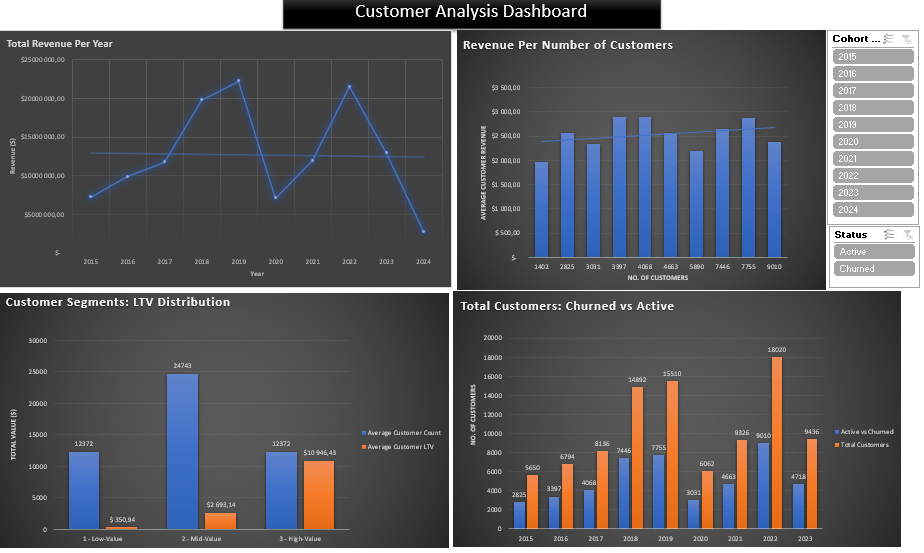

# Sales Data Analysis 

## Project Overview 
Analysis of customer behaviour, retention and lifetime value for an e-commerce company in order to improve customer retention and maximize value. Analysis was conducted using the contoso dataset.
## Business Questions 
1. **Customer Segmentation** Who are the most valuable customers?
2. **Cohort Analysis** How do different customer groups generate revenue? 
3. **Retention Analysis** Which customers have not made any purchases recently?

## Analysis Approach 

### 1. Customer Segmentation Analysis
- Categorised customers based on total lifetime value (LTV)
- Assigned customers to high High, Mid and Low-value segments. 
- Calculated the total revenue.

View query: [1_customer_segmentation.sql](1_customer_segmentation.sql) 

### Key Findings 
- The mid-value segment forms the largest customer base at 24,743 customers- approximately double the amount of low-value (12,372) and high-value customers (12,372). 
- Despite making up 25% of the customer count, the high-value segment generates an average LTV of $10,943.43 which is over 4 times higher than mid-value ($2,693.14) and more than 31 times higher than low-value ($350.84). 
- A notable finding is that by moving a small percentage of mid-value customers into the high-value segment would substantially increase overall revenue.

### 2. Cohort Analysis
- Tracked revenue and customer count per cohort.
- Cohorts were grouped by year of first purchase.
- Analysed customer retention at a cohort level. 

View query: [2_cohort_analysis.sql](2_cohort_analysis.sql)

### Key Findings 
- There is a positive overall trajectory from roughly $2,400 at the lowest customer count (1,402) to around $2,800 at the highest customer count (9,010), indicating that larger customer segments sustain higher per-customer value. 
- Average customer revenue hits the highest point at roughly $2,890 twice- at 4,068 and 7,755 customers, alongside 3,397 customers at approximately $2,950. 
- 9,010 represents the largest customer count, but average revenue drops to roughly $2,500- a 16.1% drop from $2,980 peak at 7,755 customers. 

### Customer Retention 
- Identidied customers at risk of churning.
- Analsyed purchase patterns.
- Calculated customer-specific metrics.

View query: [3_retention_anlysis.sql](3_retention_analysis.sql)

### Key Findings 
- Total customers grew steadily from 5,650 in 2015 to a peak of 18,020 in 2022 before dropping nearly 50% to 9,436 in 2023.
- Total customers fell by roughly 61% from 15,510 in 2019 down to 6,062 in 2020, followed by a two year recovery. 

# Visualisation 
Using the data that was obtained from SQL queries, an excel dashboard was used to visualise key findings.

# Strategic Recommendations
1. Protect the high-value LTV and build a system or path that allows mid-value customers to move up to the high-value segment.
2. Further investigate the reasons for peaks and dips in annual revenue. 
3. Build more predicatable recurring revenue such as repeat purchase cadence, renewals or recurring commitments so that revenue relies less on one-time spikes. 

# Tools That I Used
- PostgresSQL
- DBeaver and VS code
- Git and GitHub
- Microsoft Excel

